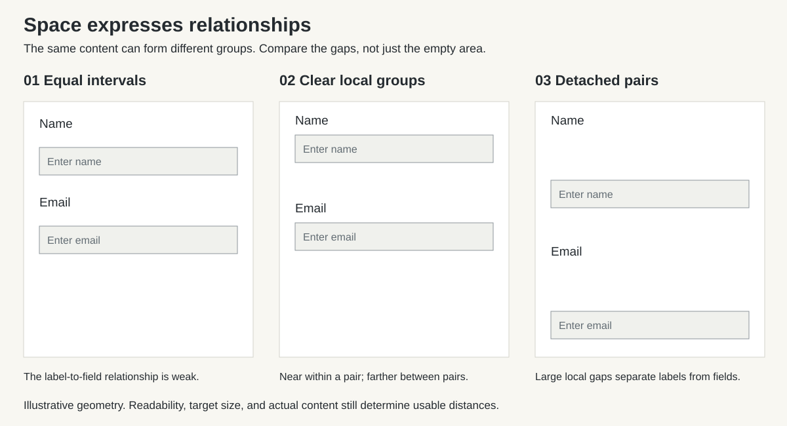
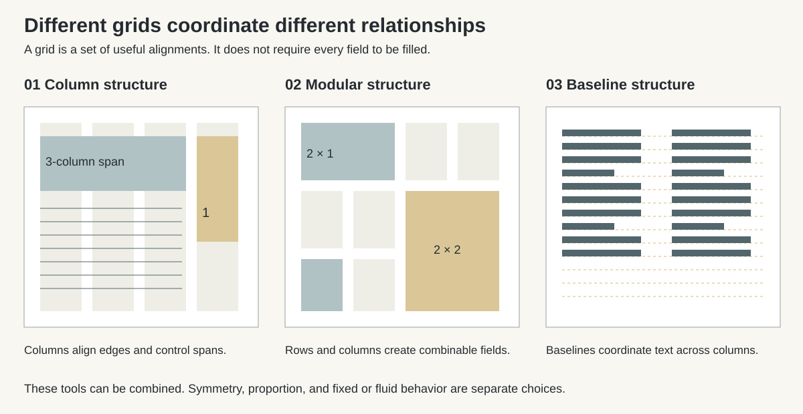

# Composition

Composition gives content a spatial argument. Position, scale, alignment, separation, and sequence tell people what belongs together, what matters, and how to proceed. The same words can read as an instruction, a footnote, an endorsement, or a warning when their relationships change. Layout therefore participates in meaning before anyone finishes reading.

Use this reference to compose interfaces, websites, publications, presentations, posters, and visual identities, and to define systems that carry those compositions across formats. A grid coordinates placement; a spacing system coordinates distances; a layout applies those systems to particular content. **Composition** includes the judgment that makes the arrangement communicate. None of these tools chooses the message for you.

## Use this reference

This guide owns spatial relationships: grouping, hierarchy, balance, space, grids, density, and layout adaptation. Apply the shared [framework](reference.md) for decision priorities, requirements language, and evidence.

For UI, read sections [2](#2-write-the-composition-brief), [5–10](#5-build-visual-hierarchy), [14–20](#14-construct-and-calculate-the-grid), and [22–24](#22-translate-design-intent-into-implementation). Use [21](#21-apply-composition-to-editorial-and-physical-formats) for physical and editorial production. [Interaction](interaction.md) defines behavior; [Typography](typography.md) defines text composition; [Accessibility](accessibility.md) defines access requirements.

## Contents

1. [Understand what composition accomplishes](#1-understand-what-composition-accomplishes)
2. [Write the composition brief](#2-write-the-composition-brief)
3. [Make spatial meaning explicit](#3-make-spatial-meaning-explicit)
4. [Use perception to clarify relationships](#4-use-perception-to-clarify-relationships)
5. [Build visual hierarchy](#5-build-visual-hierarchy)
6. [Guide attention and reading](#6-guide-attention-and-reading)
7. [Balance weight, tension, and rhythm](#7-balance-weight-tension-and-rhythm)
8. [Compose blank space](#8-compose-blank-space)
9. [Choose minimalism and density deliberately](#9-choose-minimalism-and-density-deliberately)
10. [Establish alignment and optical order](#10-establish-alignment-and-optical-order)
11. [Choose scale and proportion](#11-choose-scale-and-proportion)
12. [Understand grid anatomy](#12-understand-grid-anatomy)
13. [Select a grid family](#13-select-a-grid-family)
14. [Construct and calculate the grid](#14-construct-and-calculate-the-grid)
15. [Coordinate type, images, and fields](#15-coordinate-type-images-and-fields)
16. [Build a spatial system](#16-build-a-spatial-system)
17. [Make responsiveness preserve relationships](#17-make-responsiveness-preserve-relationships)
18. [Preserve accessible and multilingual order](#18-preserve-accessible-and-multilingual-order)
19. [Compose layers, states, and time](#19-compose-layers-states-and-time)
20. [Apply composition to interfaces](#20-apply-composition-to-interfaces)
21. [Apply composition to editorial and physical formats](#21-apply-composition-to-editorial-and-physical-formats)
22. [Translate design intent into implementation](#22-translate-design-intent-into-implementation)
23. [Work through complete examples](#23-work-through-complete-examples)
24. [Review, diagnose, and hand off](#24-review-diagnose-and-hand-off)

## 1. Understand what composition accomplishes

### Reduce the work of interpretation

People need to recognize a surface, locate relevant content, understand relationships, and act or continue reading. Weak composition makes them infer structure from scattered fragments. Strong composition exposes that structure through a few dependable relationships.

A label close to its field identifies ownership. A common edge lets a reader compare values. A stable title position helps someone recognize a new page. A generous interval can distinguish chapters without adding another box. These effects are useful because they serve actual tasks, not because spacing itself guarantees trust or beauty.

Composition also determines what fits in view, how far related information lies apart, and how much scrolling or page turning a task requires. It influences comfort and comprehension alongside legibility, content quality, prior knowledge, and interaction. Do not claim that a pleasing layout alone proves usability, conversion, or accessibility.

### Work at connected scales

| Scale | Main decision | Example |
| --- | --- | --- |
| Whole experience | How regions and moments form a coherent sequence | Overview, evidence, comparison, decision, confirmation |
| Page or screen | What dominates, what supports it, and what is adjacent | Main workspace beside a contextual inspector |
| Section or module | How a local message or task is grouped | A heading, explanation, control group, and result |
| Component | How content and interaction fit together | Label, value, unit, action, error, and target area |
| Detail | How visible shapes and spaces resolve | Caption gap, icon alignment, punctuation overhang |

Resolve the large relationships before polishing small distances. Fine padding cannot rescue a screen whose primary task is misplaced. Recheck the whole after local refinement: a sequence of individually attractive modules can still form an exhausting page.

### Separate structural clarity from style

Order can support quiet, exuberant, dense, sparse, symmetrical, or deliberately irregular work. The default is a legible structure suited to the brief. Minimalism, maximalism, Swiss typography, and expressive collage are possible directions, not definitions of quality.

Give decorative choices a compositional role: reinforce identity, connect regions, establish rhythm, frame an image, or create a purposeful interruption. Remove decoration that merely competes with the message. Preserve expressive elements that carry the idea even when they are not strictly functional controls.

## 2. Write the composition brief

### Start with real content and conditions

Before choosing columns, identify the content, its relationships, the audience's task, and the output constraints. Collect typical and difficult examples. Placeholder text conceals long labels, uneven descriptions, awkward crops, and variable data.

Record these decisions in a short brief:

| Question | Useful answer |
| --- | --- |
| What must people understand or accomplish? | Name the decision, action, reading experience, or impression. |
| What deserves attention first? | State the primary message or task and its supporting evidence. |
| Which things must be compared or kept together? | Identify pairs, sequences, groups, and dependencies. |
| How will people encounter it? | Search result, familiar workspace, passing glance, seated reading, presentation, or physical navigation |
| What is fixed and what can vary? | Format, content length, language, assets, brand elements, input, and production limits |
| What should the arrangement express? | Describe concrete qualities such as open margins, decisive scale contrast, or compact aligned rows. |
| What must survive adaptation? | Priority, sequence, association, access to actions, and identity |
| How will the result be judged? | State observable tasks and the viewing conditions for proof. |

A useful direction says: “Present the work like an architectural catalogue: strong image fields, short factual captions, a stable leading edge, and deliberate pauses between projects.” “Make it clean and modern” leaves the composition undecided.

### Inventory content before allocating slots

Classify content by role and variability: primary claim, explanation, evidence, navigation, metadata, controls, exceptions, and recovery. Identify optional material and what happens when it is absent. Distinguish author-controlled copy from user content that cannot be shortened to fit.

Sketch different macrostructures using the same content. For a project case study, compare image-led chapters, a continuous narrative, and a side-by-side evidence structure. Choose the one that supports the reading task. Do not begin with a standard hero, three cards, testimonial, and final action unless the content warrants that sequence.

A small thumbnail is useful for comparing mass, space, and emphasis. It cannot establish text legibility or operability. Develop the selected structure at actual reading size before treating it as viable.

## 3. Make spatial meaning explicit

### Treat placement as a claim

An arrangement implies relationships even when the designer did not intend them. Review those claims alongside the literal content.

| Spatial choice | Likely implication to examine | Failure to avoid |
| --- | --- | --- |
| Close placement | These elements belong together | An error appears attached to the next field. |
| Common boundary | These items share a function or category | An advertisement appears to be part of a trusted result. |
| Larger area or stronger position | This deserves greater importance | A promoted option looks objectively superior. |
| Equal size and treatment | These items have comparable status | A minor note competes with the primary warning. |
| Indentation | This is subordinate to the containing item | A peer option appears dependent on another. |
| Sequence | This comes before, causes, or prepares the next | Correlation is presented like a causal process. |
| Overlap or foreground placement | This covers, interrupts, or takes priority | A decorative layer appears interactive or blocks a control. |
| Isolation | This is distinct, significant, or separate | Essential help seems unrelated to the task. |

These are interpretations to test, not a universal cultural dictionary. Reading direction, conventions, language, genre, and familiarity affect them. A central placement can convey ceremony in one context and merely a default template in another.

### Represent relationships honestly

Keep prices with conditions, charts with units, claims with relevant qualifications, and choices with their consequences. Do not obtain a cleaner composition by detaching information needed to judge the main message. An independent caption or disclosure may be appropriate, but its connection must remain evident.

Distinguish decoration from data. An irregular arrangement of values must not suggest an order or magnitude that the data does not have. A connecting line in a diagram asserts a relationship; use it only when that relationship exists. Equal card dimensions can support fair comparison, while an intentionally dominant sponsored item needs clear labeling.

Let hierarchy serve the person's decision. Declining, canceling, correcting, or choosing a less profitable option must remain findable and usable. Aesthetic restraint does not justify making alternatives disappear.

## 4. Use perception to clarify relationships

### Make grouping cues agree

People organize visible elements into groups. Distance, similarity, boundaries, alignment, and connectedness can reinforce one another or disagree. Use the fewest cues that make the intended relationship clear.

| Cue | Application | Condition or exception |
| --- | --- | --- |
| Proximity | Keep a caption closer to its image than to the next image. | Preserve that relationship when columns stack. |
| Similarity | Repeat the appearance of controls with the same role. | Necessary differences in state still need distinct cues. |
| Common region | Enclose a self-contained object or complex group. | A border around every sentence adds competing structure. |
| Connectedness | Link nodes in a process or show a selected item controlling a detail pane. | Connections must remain traceable and meaningful. |
| Continuity | Use aligned edges or a consistent direction to support a sequence. | A visual continuation must not imply unavailable interaction. |
| Closure | Let a partial outline suggest a simple decorative form. | Essential instructions and controls need explicit identification. |
| Figure and ground | Keep content distinguishable from its supporting field. | Pattern, transparency, and imagery can reverse the intended dominance. |

Start with proximity and alignment. Add containment when the group needs a visible boundary, independent interaction, or stronger separation in a dense setting. A card is justified by the content's role, not by the availability of a card component.

### Compare the strength of competing cues

A shared background can overpower a subtle gap. An isolated red label can pull attention away from a large muted heading. A vertical divider can split information that text says belongs together. When grouping fails, inspect the strongest visible cue rather than increasing every margin.

For example, keep a field label, hint, input, and error in one local group. Use a larger interval before the next field group. If every vertical interval is equal, the label may appear to describe the preceding input. If the error has a strong full-width background, check that it does not visually absorb neighboring fields.

## 5. Build visual hierarchy

### Rank content before styling it

Define the main message or task, the information that supports it, and the detail available for inspection. Start with a small number of clearly different emphasis roles. Add a role only when it represents a real distinction.

Hierarchy can operate locally. A workspace may contain several independent tools, each with a local heading and primary action. It need not have one oversized headline or one globally dominant button. The active task should be clear without making every useful control visually weak.

Separate these hierarchies:

- **Information hierarchy:** category, part, dependency, and sequence.
- **Visual hierarchy:** relative salience and emphasis.
- **Interaction hierarchy:** current task, available actions, and consequences.
- **Semantic hierarchy:** headings, landmarks, lists, tables, and programmatic relationships.

Coordinate them. A visually small section title can still be a semantic heading. A large numeric value can dominate a dashboard without being a document heading.

### Allocate emphasis as a limited resource

Use scale, weight, contrast, location, area, isolation, detail, and motion deliberately. Begin with one or two strong differences. If a heading already has clear scale and space, it may not also need a saturated background, icon, rule, and shadow.

Reduce competing signals before making the focal element louder. An image with a face, bright highlight, or dense texture may dominate even when its bounding box is smaller. Review actual assets rather than treating all rectangles as equivalent visual weight.

A useful test is to reduce the composition to a small overview and identify its major masses. Then return to normal size and try the actual task. Thumbnail clarity does not excuse unreadable supporting text. Grayscale and blur are optional hierarchy diagnostics; they do not prove contrast compliance, accessibility, or a viewer's gaze sequence.

### Preserve quiet information

Secondary content still needs to be readable and discoverable. Use consistent placement and restrained weight rather than extremely small text or weak contrast. Metadata may sit back; a condition that changes a purchase decision must not be demoted to illegibility.

For peer choices, give comparable information comparable treatment. Express a genuine recommendation through an explicit label and reasons. Do not rely on a larger default option to conceal the absence of a substantive advantage.

## 6. Guide attention and reading

### Provide an entry and a next step

Choose where the composition invites entry, what resolves the initial question, and where a person can continue. A poster might move from event title to image to date. A support page might begin with a specific answer and then offer steps and exceptions. An expert tool may begin with the selected object and its current state.

A visual route is a design hypothesis. People may enter through search, skip familiar content, pursue a specific task, or read in a different direction. F-shaped and Z-shaped descriptions are observations or heuristics for certain conditions; they are not templates that every layout should imitate.

Keep a meaningful reading sequence in the source or document structure even when the visual presentation permits several routes. Avoid a composition that only makes sense when the viewer follows an imagined eye path.

### Use direction with purpose

Aligned edges, numbered stages, connectors, repeated shapes, image perspective, and a subject's gaze can encourage continuity. Use explicit arrows for actual direction, change, or process. Decorative arrows can suggest controls or causal links that do not exist.

In imagery, leave room in the direction of a meaningful gaze or movement when that supports the message. Compare it with a tighter crop or opposing direction if the brief calls for tension. A composition can intentionally resist an expected direction, but important information must remain recognizable.

Offer subordinate exploration where it serves understanding: a diagram beside an explanation, a detail crop, or a short supporting note. Keep the connection back to the main subject evident. Additional paths should reward relevant inquiry, not merely increase time spent looking.

### Pace the sequence

Alternate emphasis according to the content: an overview, a detailed passage, a comparison, a pause, a conclusion or action. Repeated intervals support predictability; a meaningful variation signals a change.

In static work, “fast” and “slow” describe intended reading experience, not measured dwell time. In digital work, people control scrolling and revisiting. Do not force a pace by hiding content behind long animations or capturing scroll for ordinary reading.

Avoid false endings. A large blank region, full-width rule, footer-like strip, or abrupt background change can make continuing content look finished. Make chapter transitions intentional and continuation discoverable through headings, flow, or a glimpse of the next region. A fake cutoff is not required on every screen.

## 7. Balance weight, tension, and rhythm

### Balance perceived mass

Balance concerns the distribution of visual weight within a frame and around its axes. Area, darkness, saturation, texture, faces, isolation, and distance from an axis all contribute. Equal widths do not guarantee equal weight. A small isolated mark can counter a much larger quiet field.

Use symmetry when equivalence, stability, ceremony, or centralized attention fits the content. Use asymmetry when the content has unequal roles or the direction benefits from tension. Asymmetry can be carefully balanced; it is not synonymous with disorder.

Inspect the perimeter as well as the center. A heavy image near an edge can make the page feel as though it is tipping out of frame. Empty space can counterweight a dense cluster. Do not fill the open side merely to make occupied areas equal.

### Resolve accidental tension

Small near-misses often look less intentional than a decisive separation or overlap. Watch for a caption almost touching a border, an object nearly tangent to a frame, two unrelated edges almost aligning, or a face awkwardly clipped by the page.

When tension has no purpose, move the objects clearly apart, align them, or establish a deliberate overlap. When tension is part of the direction, concentrate it around the intended message and keep a stable region that lets the viewer orient.

Deliberate disruption is most appropriate in expressive communication. A rotated title, irregular interval, or cropped display form can carry energy. In a payment form or error recovery flow, obstructing the route usually harms the task. Do not treat discomfort as evidence of sophistication.

### Establish repetition with variation

Repeat important relationships: image-caption gaps, heading positions, column edges, section intervals, and metadata placement. These repetitions create a rhythm that makes differences noticeable.

Vary a relationship when the content changes role. A chapter opener can be more spacious than an internal spread; an urgent exception can interrupt routine rows. If every section uses a different arrangement, the reader repeatedly relearns the system. If every section is identical despite different content, the composition becomes monotonous or misleading.

Inspect sequences as sequences: a contact sheet of pages, a strip of slides, or a scroll overview. A local design can be attractive while its repetition creates long empty stretches, unbroken density, or a predictable alternation unrelated to the argument.

## 8. Compose blank space

### Treat absence as a visible form

Blank space, white space, and negative space describe areas not occupied by the composition's focal content. They need not be white or literally empty. A quiet coloured field or an undetailed part of a photograph can perform the same role. A highly textured background may contain few objects while providing little visual rest.

Space is a material of composition. It can join, separate, frame, isolate, establish scale, direct a route, create anticipation, or leave room for interpretation. Its shape, continuity, and position matter as much as its total area. There is no useful universal percentage of a page that must remain blank.

### Distinguish kinds of space

| Kind | Where to inspect | Decision it supports |
| --- | --- | --- |
| Micro space | Within and between words, lines, icons, labels, and controls | Legibility, local grouping, and target distinction |
| Macro space | Margins, columns, section intervals, and unoccupied fields | Hierarchy, pacing, balance, and orientation |
| Interior space | Padding and the clear field within an object | Content fit and the perceived unity of the object |
| Exterior space | The interval between objects or groups | Relationship and separation |
| Passive space | Space needed for the composition to function | Legible lines, basic margins, room for interaction |
| Active space | Deliberately emphasized absence | Isolation, a directional opening, a pause, or a meaningful silhouette |

These categories overlap. A margin can be both practically necessary and actively expressive. Use them to identify the purpose of a gap, not to classify every pixel.

### Make distances express closeness

For comparable elements in a nested structure, default to smaller distances within a group and larger distances between groups. Establish a noticeable difference without making related information remote.

An illustrative form might use 4 units from label to input, 8 from input to supporting text, 24 before the next field group, and 40 before a new section. The exact values depend on type, controls, and density. The useful rule is the relationship among them. Do not reduce an interactive target merely to preserve a small visual interval.

A heading should usually sit closer to the content it introduces than to the preceding group. A figure's caption should remain attached when the figure spans columns. A page can have generous margins and still feel cramped if its internal relationships have no room.



### Create breathing room where pressure occurs

Breathing room is enough quiet separation for the current content and task to be perceived without avoidable competition. Diagnose the pressure before adding space:

- If lines merge, inspect type size, measure, and leading.
- If labels attach to the wrong objects, change relative intervals.
- If every block demands attention, reduce emphasis and decoration.
- If a dense cluster touches the frame, reconsider its boundary and margin.
- If a control feels crowded, allow its label, target, focus indicator, and nearby controls enough clearance.

Increasing all padding cannot fix all five problems. It may hide poor hierarchy while pushing the main task out of view. Similarly, shrinking content creates more blank area but can make the experience less comfortable.

### Compose the shape of the void

Look at the negative shapes between objects: a channel down the page, a wedge toward the focal point, an open margin beside prose, or a pocket around a mark. Their direction can reinforce the composition.

Avoid unplanned slivers, trapped gaps, and several nearly equal but inconsistent intervals. A narrow empty strip between a photo and a panel can read as an error rather than an intentional channel. Make the separation decisive or connect the regions.

Connected open areas can unify an irregular arrangement. A scattering of small gaps can instead make it feel fragmented. Test both the occupied silhouettes and the unoccupied field. In an image-led page, inspect the actual quiet areas inside photographs alongside the external margins.

### Use isolation without detachment

Additional space can give an element importance because it separates that element from competing content. Keep necessary relationships intact. A price isolated from its conditions becomes harder to judge; a help link placed in a distant corner may be missed by a person focused on a form.

For a campaign, a large quiet region around a single object may express scale, restraint, solitude, or possibility. Those meanings depend on context. Do not assume that abundant space always means luxury or that sparse work is inherently more sophisticated.

### Recognize excessive space

Space is excessive when its cost exceeds its purpose: it weakens association, hides useful content, increases travel between compared values, creates false endings, or turns a routine task into repeated scrolling.

Judge it at the actual window height as well as width. A spacious desktop hero can consume several short laptop or landscape-phone screens. A dashboard with two visible rows may defeat its monitoring purpose even though every card has generous padding.

Before reducing space, identify whether the problem is an oversized image, unnecessary container, unsuitable measure, or repeated region. Repair the cause. Preserve the intervals needed for legibility and interaction.

### Leave room for change

Useful blank space can accommodate a longer label, a focus outline, a new state, or modest content growth. It is not a substitute for flexible layout. A fixed card with spare room still fails when content exceeds that reserve.

In templates, define what an intentionally unoccupied region means. It may be a brand field, a future-content slot, an ad reservation, or an editorial pause. Do not leave an accidental hole when an optional item is absent. Either retain the space for a stated purpose or let the remaining content close up coherently.

## 9. Choose minimalism and density deliberately

### Minimize avoidable work

Minimalism is useful when subtraction clarifies the essential message or task. It can reduce competing emphasis and make relationships easier to perceive. Removing labels, instructions, distinctions, or visible actions can instead transfer work to memory and guesswork.

Use this subtraction test: remove the element, then try the task. If identification, choice, comprehension, operation, recovery, or identity becomes worse, restore or redesign it. An explanatory label can make a composition simpler to use even though it adds visible content.

Retain the minimum effective structure. A comparison table may communicate more clearly than several sparse cards. A visible toolbar may be more useful than an empty screen with an undisclosed gesture. Progressive disclosure belongs around infrequent or advanced detail; keep prerequisites and current-task controls apparent.

### Distinguish kinds of density

**Content density** concerns how much useful material is available. **Visual density** concerns how crowded and stimulating it appears. **Interaction density** concerns how many controls and targets compete in a region. A dense table can be visually calm because alignment and repetition reduce ambiguity. A sparse landing page can feel noisy because every object has a different treatment.

Choose density around the task:

| Task | Useful default | What to protect |
| --- | --- | --- |
| Focused reading | Bounded measure and clear paragraph rhythm | Sustained reading without constant visual interruption |
| Infrequent consequential form | Explicit groups, labels, and adequate separation | Understanding and correction over compactness |
| Repeated expert operation | Compact stable rows and visible useful controls | Comparison, shortcuts, and low travel between related items |
| Monitoring | Glanceable summary plus inspectable detail | Important exceptions without overwhelming routine state |
| Browsing a collection | Repeatable units and enough items to understand the range | Honest previews and accessible filtering |
| Expressive campaign | A clear idea with deliberate concentration and release | Identity and essential information across formats |

Do not infer expertise or preference from screen size. Offer density controls when users have sustained reasons to choose differently. A compact mode can reduce gaps and secondary metadata while preserving essential labels, legibility, target requirements, and access to the same task.

### Distinguish complexity from clutter

Complexity may belong to the subject. Clutter arises when the presentation adds avoidable competition or ambiguity. Remove redundant lines, repeated labels, unnecessary cards, decorative badges, and duplicate emphasis before deleting meaningful data.

When comparison is central, keep related values simultaneously available where practical. Moving every value to a separate screen can reduce visible density while increasing cognitive work. When the content truly exceeds a useful overview, provide a summary, filters, stages, or drill-down with a clear route back.

## 10. Establish alignment and optical order

### Choose a few meaningful anchors

An anchor is a repeated edge, axis, or baseline that coordinates elements. Establish the page boundary, main content edge, local text edges, and any comparison axes. Reuse them across related sections.

Default to start alignment for ordinary prose and long labels. Center short, self-contained material when the composition has a clear central axis. Centering several unrelated text blocks produces changing start positions and makes scanning harder. End alignment can support specific roles, such as aligned numeric values, but is not a general substitute for a reading edge.

Align according to the task. Values in a table may need decimal alignment, labels need consistent association, and controls may need baseline or center alignment depending on their shapes. Do not align all objects by their bounding-box top if that creates an uneven visible row.

### Coordinate nested boundaries

Decide whether an image edge aligns with a container edge or the text inset. Either can be coherent. A bleed image can reach the container boundary while text follows a consistent inner edge. Make that distinction repeatable.

Watch cumulative indentation. A page margin plus section padding plus card padding can leave a narrow text column inside a wide screen. Remove redundant containers or let related elements share an edge. Avoid adding a new alignment axis for every module.

### Use optical correction after structural alignment

Visible shapes do not occupy their boxes evenly. An open-sided letter, a triangular icon, a circular mark, or transparent padding inside an image can appear misaligned despite equal coordinates.

Start with structural alignment, inspect the visible mass at intended size, and make the smallest necessary optical correction. Correct an asset's accidental transparent padding at the asset layer where possible. Keep exceptions documented and stable across a family. Numerous arbitrary offsets usually indicate a weak base system.

Allow punctuation to hang into a margin in controlled editorial composition when it improves the perceived text edge. Do not let optical corrections obscure focus indicators, reduce targets, or shift semantic reading order.

## 11. Choose scale and proportion

### Derive relationships from content

Scale establishes relative importance and physical usability. Proportion describes relationships among dimensions or regions. Start with readable text, viable controls, meaningful images, and the smallest useful content width. Then choose divisions that support those needs.

A 2:1 main-to-support division can be a useful starting point for an article and a short contextual rail. Equal columns suit equal comparisons. A narrow navigation region and flexible workspace suit a tool. The same ratio can be successful or unsuitable depending on its actual dimensions.

Do not make a sidebar so narrow that labels become a stack of single words merely to preserve a preferred proportion. Do not stretch prose across an ultrawide screen because the main region is defined as a percentage.

### Use ratios as proposals

Simple fractions, thirds, aspect ratios, and geometric constructions can reduce arbitrary choices or provide an expressive starting point. They cannot establish the correct hierarchy, ideal reading width, or most appropriate crop.

The golden ratio is approximately 1:1.618. It is an optional proportion, not a requirement or evidence of inherent superiority. Reject retrospective circles or spirals as proof that an admired work was designed with that system. Choose a ratio because it helps the current composition and survives its constraints.

The rule of thirds divides a frame with two equally spaced horizontal and two vertical lines. It can help test off-center placement in imagery. It is not a nine-slot interface grid or a prohibition on centering. Compare a centered, third-based, and content-led crop when the choice matters.

### Coordinate aspect ratios with subjects

Standard image ratios make a repeated collection orderly. Choose them according to what must remain visible. A tall object, diagram, or document may need its full silhouette. A landscape scene may tolerate different crops. A portrait's gaze and face need deliberate positioning.

Specify whether an image crops, contains, bleeds, or changes source across formats. Set a focal region rather than assuming the geometric center is the subject. A new crop must preserve factual context; do not crop evidence or identity misleadingly.

## 12. Understand grid anatomy

A design grid is a coordinated set of guides and intervals. It may be drawn in a design file, encoded in layout rules, or implicit in repeated placement. It does not need a visible line around every field.

| Part | Meaning | Decision |
| --- | --- | --- |
| Format or frame | The available page, screen, panel, or physical field | What is visible, reachable, and producible? |
| Safe or live area | Region protected from trim, binding, overlays, or system obstruction | Where can essential content reliably remain? |
| Type or content area | Field allocated to the main composition | How much room remains after boundaries and margins? |
| Margin | Space outside the main content field | How does content relate to the frame and other pages? |
| Column | Vertical division used for alignment or allocation | Which divisions support the required content widths? |
| Gutter | Space between neighboring tracks or fields | How are they separated without losing association? |
| Row | Horizontal division or repeated band | Is its height fixed, content-driven, or related to a baseline? |
| Module or field | A unit formed by rows and columns | What can occupy or span one or more units? |
| Flowline | A horizontal alignment used across regions | Where do starts, transitions, or captions coordinate? |
| Baseline | The line on which text characters sit | Where does typographic alignment matter? |
| Span | Several adjacent tracks and their internal gutters | Which content needs greater width or area? |
| Anchor | A stable edge, axis, or alignment point | What remains consistent across variations? |

A design column is not necessarily a text column. An article can span eight narrow grid columns while remaining one continuous reading column. A 12-column system does not imply twelve visible objects.

Separate the spacing unit from the column width. A small modular unit can govern gaps while columns expand fluidly. Fractional track widths are normal in responsive layout. Do not round every track independently and accumulate errors at the far edge.

## 13. Select a grid family

### Choose structure by the recurring problem

| Family | Suitable use | Main limitation |
| --- | --- | --- |
| Manuscript or single-column | Continuous reading, focused forms, simple posters | Supporting material needs a clear insertion or rail strategy. |
| Multicolumn | Coordinated text/image regions, editorial pages, comparative content | Narrow tracks must combine into useful widths. |
| Modular | Catalogues, repeated cells, schedules, multi-part editorial fields | Fixed rows can fail with variable content; equal area can imply equal importance. |
| Hierarchical | Unequal content roles arranged around a strong priority | Needs repeatable anchors and explicit adaptation to avoid arbitrary placement. |
| Baseline | Coordinating text across adjacent columns or pages | It governs vertical text rhythm, not the entire page structure. |
| Compound | Two coordinated structures serving different content in the same family | Extra alignments can become confusing or hard to maintain. |
| Radial or circular | Central relationships, dials, certain diagrams and identity work | Poor default for ordinary sequential text or large numbers of labels. |
| Axonometric, triangular, or other geometric | Illustration, maps, spatial explanation, patterns | Geometric construction does not establish reading order or usability. |

These are overlapping tools. A modular page can also be asymmetric and use a baseline grid. A square grid is a particular module shape. A golden-ratio guide describes a proportion. Do not treat every named variant as a distinct system that a project must support.



### Choose behavior separately

**Fixed fields** retain a chosen size while the number or placement of fields changes. **Fluid fields** expand or contract within useful bounds. **Adaptive structures** change arrangement at defined conditions. **Hybrid layouts** combine these behaviors.

When extra width should reveal more objects, prefer tiling useful-sized fields. When extra width should reveal more of each object, let regions expand within readable limits. A gallery and a document editor may therefore use different behavior on the same display.

A grid can be symmetrical or asymmetrical, strict or permissive. Make those choices independently from the family. A consistent asymmetric grid can be more systematic than a centered composition full of arbitrary gaps.

### Use free composition when it serves the idea

A compact poster, collage, art-directed title, or expressive image may not benefit from a conventional column grid. Still define relationships: focal point, axes, clusters, negative shapes, frame tension, and reading information. Free composition needs coherent judgment.

Breaking a grid creates contrast only when enough order remains perceptible. Choose what breaks it, why, and what stays aligned. A full-bleed image, oversized pull quote, or diagonal title can be an intentional exception. If everything is exceptional, the grid no longer explains the work.

## 14. Construct and calculate the grid

### Build outward from the hardest content

1. Establish format, safe areas, output conditions, and actual content.
2. Set a readable text measure and viable widths for important controls, images, diagrams, or data.
3. Choose margins that support framing and practical constraints.
4. Test the simplest column structure that accommodates the recurring relationships.
5. Choose gutters that separate adjacent fields at the intended size and density.
6. Add horizontal modules or flowlines only where they coordinate real content.
7. Test the densest, sparsest, longest, and most awkward cases.
8. Revisit the whole structure when the results fail. Do not progressively shrink type to defend the first grid.

A 12-column grid allows many common fractions, including halves, thirds, and quarters. Four, six, eight, or sixteen columns may fit the work better. A focused reading page may need no explicit multicolumn grid. Use only enough divisions to support useful variation and alignment.

### Calculate tracks and spans

For equal columns, let:

- `W` be the total frame width.
- `L` and `R` be its start and end margins.
- `n` be the column count.
- `g` be the gutter width.
- `c` be the resulting column width.

Then:

```text
Content width = W - L - R
c = (W - L - R - (n - 1) × g) / n
Width of a k-column span = k × c + (k - 1) × g
```

An illustrative 1440-unit frame with 96-unit side margins, 12 columns, and 24-unit gutters has a 1248-unit content area. Eleven gutters consume 264 units. Each column is 82 units. A four-column span is 400 units; an eight-column span is 824. Those two spans plus one gutter occupy the full 1248 units.

Check the content, not just the sum. A 400-unit rail might be too wide for short navigation or too narrow for a detailed comparison. Change the structure when a mathematically correct result is functionally wrong.

For unequal columns, define useful minimums and allocate the remaining room according to roles. Track boundaries can still align across sections. Equal columns are a convenience, not a prerequisite for a grid.

### Derive a tiling threshold

For `k` equal items with minimum useful width `m` and gap `g`, the required container width is at least:

```text
k × m + (k - 1) × g
```

Three 280-unit items with two 24-unit gaps require 888 units inside the container. Two require 584. Outer padding belongs outside that calculation. These are trial thresholds, not named device breakpoints. Test them with real content, text enlargement, and the actual layout engine.

### Construct editorial modules carefully

For a controlled content area of height `H` divided into `r` equal rows with gutter `v`:

```text
Module height = (H - (r - 1) × v) / r
```

Coordinate this height with the baseline rhythm when alignment across columns matters. If a text field is intended for `q` line boxes of height `b`, budget `q × b` for those boxes. Actual first-baseline offsets, paragraph spacing, captions, and inset settings also affect fit; verify them in the composition engine.

A grid field can hold a picture, text, a colour field, or intentional space. Let significant content span multiple fields. On the web, default to content-driven row heights unless a fixed media or canvas role justifies a constraint. Editorial modularity does not authorize clipping variable prose.

## 15. Coordinate type, images, and fields

### Make the text block part of the grid

Use [Typography's paragraph conventions](typography.md#15-compose-readable-paragraphs) to establish the text block before allocating its grid span. Coordinate adjacent baselines through [typographic rhythm](typography.md#16-build-hierarchy-and-page-rhythm).

A wide page can contain a bounded reading column, a wider figure, and a narrow note rail. Align their relationships without forcing all three to have the same width.

### Choose image relationships explicitly

Decide whether an image leads the message, provides evidence, sets context, illustrates a procedure, or supplies atmosphere. Allocate area and placement accordingly. An evidence image may need enlargement and a detailed caption; an atmospheric image should not displace the essential answer.

For a repeated collection, coordinate subject scale as well as frame size. Identical rectangles with radically different object sizes can feel uneven. For product comparison, preserve enough consistency that cropping does not imply misleading size differences.

Keep images, legends, credits, and captions related at every adaptation. Avoid a caption stranded at the top of a new page or a legend separated from the chart it explains. On a small screen, place a necessary legend near the chart rather than preserving its distant desktop location.

### Integrate colour fields and rules

A large quiet colour field can frame content or create rhythm. It also has visual weight. Dark bands, strong outlines, and saturated panels can dominate even when they contain little information.

Use rules to separate or connect where that relationship needs reinforcement. Align their ends to an established boundary unless an intentional bleed serves the composition. Avoid a line between every item when spacing already makes the distinction clear. If removing a rule makes groups ambiguous, restore it or strengthen a different cue.

## 16. Build a spatial system

### Separate values, roles, and patterns

A spacing scale is a controlled vocabulary of distances. A role explains what a distance does. A layout pattern coordinates several roles for a recurring task.

An illustrative scale might include 4, 8, 12, 16, 24, 32, 48, 64, and 96 units. Useful roles could include `label-gap`, `control-gap`, `group-gap`, `section-gap`, `page-inset`, and `column-gutter`. Two roles can initially share a value and later diverge for a reason.

Do not invent a token for every distance used once. Do not force hairlines, glyph metrics, safe areas, intrinsic media ratios, or optical corrections onto a spacing scale. Existing product and platform conventions take precedence over introducing a new base unit for its own sake.

### Specify relationships and limits

For each layout pattern, document:

| Contract | What to state |
| --- | --- |
| Purpose | Reading, comparing, browsing, editing, monitoring, or deciding |
| Regions | Required and optional content, their priority, and associations |
| Dimensions | Minimum useful widths, maximum measure, insets, gutters, and spans |
| Growth | Which region stretches, wraps, scrolls, or adds items |
| Adaptation | What triggers a structural change and the resulting order |
| State | Loading, empty, error, selected, expanded, and permission variations |
| Input | Pointer, touch, keyboard, focus expansion, and virtual keyboard needs |
| Localization | Long text, script metrics, bidirectionality, and directional exceptions |
| Exceptions | Purposeful bleed, overlap, optical offset, or local grid variation |
| Proof | Representative content and conditions that demonstrate the contract |

A token list without these decisions is not a composition system. A screenshot without constraints does not tell an implementer how the layout should behave between captured sizes.

### Preserve a recognizable family

Carry a small set of relationships across surfaces: a title position, proportion contrast, image treatment, type roles, spacing hierarchy, or distinctive empty field. Allow the arrangement to change with the medium.

A poster, thumbnail, article, and mobile screen need not be scaled copies. Their shared identity can survive through consistent emphasis and visual language. Identify what is invariant and what is allowed to recompose. Avoid turning one successful page into the compulsory template for every task.

## 17. Make responsiveness preserve relationships

### Adapt to available space and actual use

Design a coherent narrow arrangement and a coherent wide arrangement. Establish the content sequence early, then decide how extra room improves the task. Also inspect short, wide windows, split views, and intermediate sizes. A width alone does not describe available space.

Use fluid values for gradual change and structural breakpoints when the arrangement stops working. Choose breakpoints from content pressure: unreadable tracks, crowded navigation, broken associations, excessive measure, or insufficient target room. Do not infer touch capability, expertise, or importance from viewport width.

For reusable components, respond to their own available container width where appropriate. A card in a sidebar may need a compact arrangement on a wide desktop. Viewport rules remain useful for the page shell. Container and viewport adaptation solve different problems.

### Define the transformation

| Transformation | Use when | Preserve |
| --- | --- | --- |
| Reflow or wrap | Items remain useful at their current size | Meaningful order and group boundaries |
| Collapse columns | Adjacent regions no longer have useful widths | The intended reading sequence and nearby evidence |
| Change orientation | A horizontal relationship works better vertically | Clear labels and correct pairing |
| Move supporting content | A rail becomes a contextual insert or disclosure | Findability and the link to the main task |
| Reduce decorative scale | Expressive media consumes too much of a small frame | The idea and essential content |
| Add local scrolling | A genuine two-dimensional task needs it | Visible context, keyboard access, and a discoverable scroll region |
| Change navigation pattern | The full navigation no longer fits | Current location, access to destinations, and clear operation |
| Add columns or cap width | Extra room is available | Useful item sizes and bounded reading measure |

Do not hide essential content to make a narrow screenshot attractive. If a task needs a different representation, preserve its information and capabilities. A stacked list may replace cards; a table may retain local horizontal scrolling. Choose according to what people need to compare.

### Preserve groups through stacking

A common failure stacks entire columns in source order and separates paired content. If the desktop shows feature A beside evidence A and feature B beside evidence B, the narrow order should usually keep each feature with its evidence. Model the content as meaningful pairs before assigning columns.

Likewise, do not let a right-hand price summary land after a long sequence if it contains information needed before choosing. Insert, summarize, or disclose it at the relevant decision point. Verify the actual reading and focus sequence rather than relying on visual placement.

### Manage large and small extremes

At very large widths, stop enlarging prose and controls. Let margins grow, reveal useful additional regions, or show more items according to the task. A spacious margin is preferable to a paragraph spanning the whole monitor.

At small widths, simplify the number of simultaneous regions before shrinking everything. Let labels wrap and controls grow vertically. At small heights, reduce oversized top space, reconsider sticky layers, and keep the current task reachable. Virtual keyboards and browser controls change the visible area; essential actions must remain reachable through normal scrolling.

Use safe-area information where system cutouts or gesture regions apply. Keep backgrounds free to bleed while protecting essential content and controls. Do not hard-code the physical geometry of one device into the reusable layout.

## 18. Preserve accessible and multilingual order

### Make visual structure available beyond vision

Apply [semantic structure](accessibility.md#8-make-structure-and-meaning-programmatic) and [scaling, reflow, and user-preference requirements](accessibility.md#7-preserve-scaling-reflow-and-user-preferences). Use the owner's [focus and target requirements](accessibility.md#9-support-keyboard-focus-and-alternative-input) when allocating control space.

CSS placement, flex reversal, dense packing, and masonry can separate visual order from document order. Establish meaningful content groups before assigning tracks; verify the resulting visual, reading, and focus sequences. A local two-dimensional region needs its own usable geometry while the surrounding page reflows.

### Localize relationships as well as text

Use logical start/end and inline/block relationships where they fit the platform. Adapt direction-sensitive navigation and sequence for right-to-left interfaces. Keep paragraphs aligned appropriately for their own script and language; mixed-language content needs deliberate treatment.

Do not mirror every asset. Photographs, logos, numerals within a number, and many real-world symbols retain their form. Use [Iconography’s per-asset direction policy](iconography.md#18-localize-meaning-and-direction) for symbols.

Test translated titles, long compound words, large numerals, diacritics, fallback fonts, and scripts with different vertical needs. Do not rely on a fixed expansion percentage as proof of fit. Avoid forced English line breaks and fixed label heights. A localized composition may need a different measure, scale, or crop while preserving the same task and identity.

## 19. Compose layers, states, and time

### Define foreground and background roles

Layers establish priority and scope. A dialog interrupts a task; a popover is anchored to a control; a sticky toolbar remains available while content moves. Specify what each layer belongs to and what it obscures. Use [Interaction’s disclosure and modality rules](interaction.md#8-choose-disclosure-and-modality) for behavior.

Use a small, named layer system instead of arbitrary escalating stack values. Keep menus, tooltips, dialogs, notifications, and persistent navigation from competing for the same space. Their interaction and semantics need separate implementation rules; geometry alone does not make a modal accessible.

Overlap can clarify depth or connect objects. It can also conceal labels, crop focus rings, and make targets ambiguous. Decorative overlap belongs outside critical text and control areas unless a tested alternative preserves their use.

### Compose the difficult states

| State | Spatial decision |
| --- | --- |
| Loading | Reserve sensible media and structural space; avoid a misleading fully populated skeleton. |
| Empty | Explain the state and next action without implying broken layout or filling the frame with decoration. |
| Few results | Let the collection remain coherent without stretching one item absurdly wide. |
| Many results | Define navigation, filtering, pagination, or loading behavior without losing context. |
| Error | Keep the message with the problem and preserve entered content. Allow the region to grow. |
| Expanded detail | Reflow related content or use a clear layer; avoid covering the action needed to continue. |
| Missing media | Keep content meaningful and rebalance the group rather than leaving an accidental hole. |
| Permission differences | Remove unavailable regions coherently and retain necessary explanations. |
| Selected or focused | Leave clearance for outlines, indicators, and any platform focus enlargement. |

Do not judge the composition from the best populated state alone. A row of equal-height cards needs a policy for uneven content; a dashboard needs a sensible arrangement when one service fails to return data.

### Protect visual stability

Reserve image and embed dimensions where known. Plan for font fallback, delayed data, validation, banners, and user-driven expansion. Unexpected shifts can lose reading position or move a control just before activation.

Let legitimate content growth occur; stability does not mean freezing every height. Prefer stable anchors and predictable insertion points. Keep a current selection, scroll context, and focused control understandable after updates.

For movement between spatial states, use [Motion’s transition structures](motion.md#12-choose-a-transition-structure) and [access alternatives](motion.md#19-provide-access-and-control).

## 20. Apply composition to interfaces

### Navigation and page shells

Distinguish global navigation, local navigation, main content, and contextual tools. Stable positions help people transfer knowledge across screens. Make the current location visible. Avoid surrounding a small task with several equally dominant navigation systems.

A sidebar is useful when persistent destinations or context justify its width. Collapse or transform it when the main task needs the room, while preserving access. A rail containing important task content is not merely decorative surplus to discard on mobile.

### Forms and decisions

Default to a clear single reading path for ordinary forms. Group fields by meaningful topic or dependency. Use side-by-side fields only when their relation and expected length justify it; an arbitrary two-column form can obscure completion order.

Keep labels, hints, inputs, errors, and local actions associated. Separate whole-form actions from actions on an individual repeated item. Keep consequence information near submission, with enough separation to distinguish cancellation or destructive actions.

A review screen should prioritize what people must verify. Use aligned summaries and clear edit routes. A spacious success illustration should not push the actual outcome, reference, or next step out of reach.

### Collections and cards

Use a repeated unit when items are independently meaningful and share an information schema. Keep image, title, metadata, and actions in consistent relative positions. Equal visual treatment supports scanning, but do not truncate essential differences to manufacture identical heights.

Choose among rows, cards, tables, and editorial arrangements according to comparison needs. Rows suit compact scanning. Tables support aligned attribute comparison. Cards suit discrete objects with visual previews. A masonry arrangement can suit loosely ordered imagery but is weaker when reading order, row comparison, or keyboard predictability is central.

Avoid using a mosaic of varied card sizes merely to make a screen interesting. Area implies priority. If one item spans more cells, identify the content reason and what happens when that item changes or disappears.

### Dashboards and workspaces

Organize by decision and relationship, not by the order in which data became available. Group a key value with its period, comparison, unit, and relevant status. Give important exceptions enough distinction without making every tile urgent.

Align related charts for comparison where possible. Coordinate scales when the analytical task requires them and label differences. Equal chart sizes do not imply comparable scales. Keep legends and controls near their scope.

For a workspace, give the main object useful room. Place frequent contextual controls within a manageable distance, and keep selection and inspector relationships visible. Allow resizing where useful, with sensible bounds and a route to restore the arrangement. Do not turn every panel into an independent scroll trap.

### Landing pages and communication surfaces

Let the content determine the structure: claim, concrete demonstration, evidence, constraints, and useful action. A hero can be image-led, text-led, comparative, or absent. Its size should reflect its role and the encounter conditions.

Use variation to articulate the argument. A comparison deserves aligned options; a process deserves stages; a case study deserves evidence and outcomes. Do not force all content into interchangeable three-card rows or alternate image/text bands by habit.

## 21. Apply composition to editorial and physical formats

### Books, reports, and magazines

Compose the page and the spread. Set format, binding allowance, type area, margins, columns, baseline behavior, folios, running heads, and figure/caption rules. Facing pages share a relationship but are not one uninterrupted canvas: binding can hide or distort material near the gutter.

Use consistent navigation furniture while allowing chapter openings and image sequences a different cadence. Keep a heading with enough following content to establish its section. Inspect isolated paragraph lines, stranded captions, awkward page turns, and repeated poor line endings in the final composition engine.

Reserve inner margins for actual binding needs and outer/bottom space for handling and orientation where appropriate. Margin proportions need not be equal. Historical constructions can inform trials; trim, paper, text, audience, and format decide the final design.

For print production, distinguish the trim edge, bleed, and live area. Confirm required allowances with the printer or production specification. Extend intended edge-to-edge backgrounds through bleed and keep essential material inside the live area. Do not treat an illustrative millimeter value as a universal printer requirement.

### Posters, slides, and signage

Compose for viewing distance, encounter time, and the role of spoken explanation. A poster needs an entry at a distance and essential details when approached. A slide should support the current point; a report page may need to carry its full argument independently.

Use larger, fewer reading groups when people cannot comfortably inspect fine detail. Keep a clear relationship between visual evidence and its explanation. Speaker notes and accessible companion material can carry detail, but they do not repair unreadable evidence shown to an audience.

For wayfinding, prioritize destinations, direction, recognition, and decision points. Decorative asymmetry or a clever ambiguous arrow can defeat the task. Confirm placement, lighting, physical obstructions, and actual sight lines.

### Packaging, identities, and format families

Design the relationship among panels, folds, seams, required information, and display orientation. Keep critical material away from structural interruptions. A composition that works flat can fail when wrapped around an object or viewed on a shelf.

For a visual identity, define how key relationships survive different shapes and sizes. A compact social image may need fewer details and a different crop than a poster. Preserve the idea through recomposition rather than shrinking the entire original.

### Native, large-screen, and spatial contexts

Use platform layout guides and input conventions. Window resizing, safe areas, text settings, focus enlargement, viewing distance, and reach affect the composition. CSS pixels, platform points, physical millimeters, and angular size are not interchangeable units.

For spatial experiences, consider field of view, comfortable depth, occlusion, and the physical work of looking or reaching. Place frequent content and controls where they can be used without repeated large head or body movements. More available space does not justify scattering a task across many distant windows. Verify current platform-specific measurements separately.

## 22. Translate design intent into implementation

### Choose layout mechanisms by their role

Use normal flow for content that naturally follows other content. Use a one-dimensional layout mechanism for a row or stack, and a two-dimensional grid for coordinated rows and columns. A design grid can be implemented through several nested mechanisms; it does not require one giant page grid.

Prefer intrinsic sizing and explicit useful limits over absolute positioning for ordinary content. Absolute positioning can suit layered artwork, annotations on a fixed canvas, or anchored overlays, provided resizing and content changes remain handled.

Specify whether dimensions include borders and padding. On the web, a consistent `border-box` convention usually makes component dimensions easier to reason about. Keep layout insets separate from asset-internal padding so the same gap is not counted twice.

### Example: a reading page with an optional contextual rail

This illustrative web pattern begins as a meaningful single-column document. The rail follows the article in source order because it contains optional related material. If it held prerequisites, that order would need to change. The example demonstrates geometry, not a complete visual or accessibility implementation.

```html
<div class="page">
	<main class="reading-layout" id="main-content">
		<article class="article" aria-labelledby="article-title">
			<header class="stack">
				<h1 id="article-title">Repairing a woven seat</h1>
				<p>Choose a repair method from the condition of the weave.</p>
			</header>
			<section class="stack" aria-labelledby="inspection-title">
				<h2 id="inspection-title">Inspect the damaged area</h2>
				<p>Check the strands and frame before choosing a repair.</p>
			</section>
		</article>
		<aside class="rail stack" aria-labelledby="related-title">
			<h2 id="related-title">Related guides</h2>
			<a href="/guides/materials">Identify the seat material</a>
		</aside>
	</main>
</div>
```

```css
*,
*::before,
*::after {
	box-sizing: border-box;
}

:root {
	--space-local: 0.75rem;
	--space-group: 1.5rem;
	--space-section: 3rem;
	--page-inset: clamp(1rem, 4vw, 4rem);
	--layout-gap: clamp(1.5rem, 3vw, 3rem);
}

body {
	margin: 0;
}

.page {
	max-inline-size: 80rem;
	margin-inline: auto;
	padding: var(--space-group) var(--page-inset);
}

.reading-layout {
	display: grid;
	gap: var(--layout-gap);
	align-items: start;
}

.reading-layout > * {
	min-inline-size: 0;
}

.article {
	max-inline-size: 65ch;
	overflow-wrap: anywhere;
}

.article > * + * {
	margin-block-start: var(--space-section);
}

.stack > * {
	margin-block: 0;
}

.stack > * + * {
	margin-block-start: var(--space-local);
}

.article img {
	display: block;
	max-inline-size: 100%;
	block-size: auto;
}

@media (min-width: 60rem) {
	.reading-layout {
		grid-template-columns: minmax(0, 2fr) minmax(15rem, 1fr);
	}
}
```

The `60rem` breakpoint is a trial value for this content. Verify it with the real font, translated text, zoom, and available height. The article's maximum measure does not force the rail to fill any particular ratio. If the rail is absent, normal grid auto-placement leaves the article in the first track; define a deliberate no-rail variation if it should instead center or expand.

Do not add `overflow: hidden` to conceal a layout failure. Handle long identifiers, large tables, and wide media at their own layer. Reserve media dimensions in the actual markup. Keep typography, focus styling, navigation bypass, and interaction behavior complete in the surrounding application.

### Check common technical causes of visual failure

A fractional track can still overflow because of a child's intrinsic minimum. Inspect item minimums, unbreakable content, and nested layout before changing the whole page width. A maximum width on a parent does not guarantee every child fits.

Use truncation only when the shortened value is sufficient for the task or the full value remains accessibly available. Essential labels, errors, amounts, and distinguishing identifiers need a better strategy than ellipsis alone.

Sticky positioning needs space and a clear scroll container. A long sticky rail can become unreachable in a short window. Test it with enlarged text and the actual sticky header rather than assuming the desktop screenshot establishes usable behavior.

## 23. Work through complete examples

These are design models for applying the guide, not reports of evaluated products. Their values are illustrative.

### A reading surface with a contextual rail

**Task:** Read an explanation, inspect two figures, and optionally open related material.

**Composition:** Use one bounded reading column. Put the title, short introduction, and first substantive section on a dependable leading edge. Allow evidence figures a wider span when detail needs it. Keep captions directly attached. Place optional related links in a quiet rail that does not compete with the title.

**Space:** Keep paragraph rhythm tighter than section rhythm. Give a major figure enough separation to be recognized as a unit, while keeping its explanation nearby. Let outer margins grow on wide screens rather than expanding prose indefinitely.

**Adaptation:** Move optional related material after the article at narrow widths. Keep figures and captions within the reading sequence. A necessary materials list belongs before the procedure, even if it occupies a rail visually on desktop.

**Failure and repair:** A long title makes the first section disappear on a short screen. Reduce unnecessary top padding or display scale and allow natural title wrapping. Do not shrink all body text. Proof the longest title, missing figure, fallback font, and enlarged text.

### A catalogue with repeated objects

**Task:** Scan objects and compare their identity, condition, and price.

**Composition:** Use repeatable image-led units with stable title, condition, and price positions. Choose the minimum useful item width from the longest plausible name and meaningful image detail. Keep filtering associated with the collection.

**Grid:** At a 1248-unit inner width, three 400-unit items with two 24-unit gaps fit. Four items would be 294 units each with three gaps. Choose between them by useful content size, not a desire to show a particular count.

**Space:** A modest interior gap can associate metadata, while the larger inter-item gutter separates objects. Use consistent subject scale where that supports comparison. Avoid adding strong boxes around every text fragment inside each unit.

**Adaptation:** Reduce column count as width decreases; do not keep four tiny cards. Cap item growth when only one result remains. If users need attribute-by-attribute comparison, offer a table or comparison view rather than making the card increasingly dense.

**Failure and repair:** Two-line names make prices jump unpredictably. First test a stable local structure that allows honest title growth. Use shared alignment or a purposeful row pattern where it improves comparison. Do not discard identifying words merely to equalize card height.

### A compact monitoring workspace

**Task:** Recognize service exceptions and inspect the relevant record quickly.

**Composition:** Keep a stable summary, grouped filters, and aligned records. Make service name, status, time, and consequence readable in one scan. Keep the selected record visibly connected to its detail panel.

**Density:** Prefer compact, calm rows over large padded cards when many records need simultaneous comparison. Use restraint in routine states so exceptions remain distinct. Reducing decorative boundaries can lower visual density without removing information.

**Space:** Put enough room between targets for dependable input, while keeping values within comparison distance. Do not distribute related numbers across the full monitor solely because the space exists.

**Adaptation:** At narrow widths, move detail into a labeled view with a clear return path. Preserve selection, filters, and position. Keep truly tabular data locally scrollable when stacking would destroy the task, and provide a useful summary where possible.

**Failure and repair:** An alert banner pushes the selected row out of view or covers its action. Define the banner's insertion and dismissal behavior, preserve context, and test the focused control after the update.

### An expressive event campaign

**Task:** Convey a distinctive idea, identify the event, and let people find date, place, and booking details.

**Composition:** Choose a dominant typographic or image idea. Establish stable positions for essential facts. Use an asymmetric cluster and an intentionally open region if that supports the concept. A grid break may intensify the focal point while supporting information remains orderly.

**Space:** Use one large quiet shape to counter the dense cluster. Check whether it reads as intentional at poster distance and in a thumbnail. Essential details can be quieter than the title while remaining legible at their intended distance.

**Adaptation:** Recompose for a square image, tall story format, and web page. Preserve the title's character, main contrast, and relationship between focal image and open field. Adjust crop and line breaks per format; do not reduce the full poster to unreadable miniature text.

**Failure and repair:** The concept survives but venue and date disappear in small formats. Simplify the detail treatment or provide a dedicated small-format variant. The campaign's expressive identity does not excuse losing its practical information.

### A printed report spread

**Task:** Read a short argument and compare three supporting figures.

**Composition:** Establish a main text measure, a compatible figure span, and a repeated caption treatment. Use a baseline rhythm for adjacent prose columns. Keep each figure close to the paragraph that introduces it, even when this leaves a field intentionally open.

**Space:** Give the binding enough clearance. Keep folios and running heads distinct from argument content. A chapter opening may be sparse; the next evidence spread may be dense without becoming a different visual system.

**Adaptation:** A downloadable accessible document needs meaningful tags and order. A web version should recompose the evidence into a continuous sequence rather than reproduce the fixed spread as an image.

**Failure and repair:** A chart's labels cross the gutter or become too small after export. Change the chart's placement, size, or representation and proof the exported artifact at intended size. A mathematically aligned spread is not production-ready until its content is usable.

## 24. Review, diagnose, and hand off

### Review at several distances and conditions

Begin with the composition's purpose, not a generic taste score. At overview scale, inspect emphasis, mass, voids, and rhythm. At normal viewing size, read and perform the task. At close range, inspect alignment, spacing, crop edges, and rendering.

Review actual content at narrow, wide, intermediate, and short-window conditions. Include long and short copy, translated text, missing assets, few and many items, loading, error, expanded states, and keyboard focus. For print and physical work, use real-size proofs and actual viewing conditions.

Useful inspection aids include grid overlays, bounding boxes, grayscale, contact sheets, and a temporary removal of decorative styling. Each reveals a particular issue. None proves comprehension, attention, or accessibility. User observation can test whether the intended relationships are understood; eye tracking can describe measured gaze under a defined study, not certify meaning by itself.

### Diagnose the cause before changing values

| Symptom | Inspect first | Likely repair to test |
| --- | --- | --- |
| No clear entry | Equal emphasis, competing imagery, unclear content priority | Rank the message and reduce competing salience. |
| Looks sparse but feels confusing | Detached relationships, missing labels, arbitrary axes | Rebuild groups and restore necessary explanation. |
| Feels crowded despite few elements | Strong outlines, texture, oversized type, weak margins | Reduce visual competition and repair local space. |
| Cannot compare values | Inconsistent positions, excessive distance, unsuitable cards | Align attributes or change to rows/table. |
| Every section feels the same | Template chosen before the argument | Give different content roles an appropriate structure. |
| Sequence feels disjointed | Unmotivated changes in edge, density, or background | Restore recurring anchors and meaningful transitions. |
| Beautiful desktop, weak mobile | Fixed heights, shrinking tracks, separated pairs | Recompose and preserve groups before reducing scale. |
| Page appears finished too early | False floor, oversized gap, footer-like band | Clarify continuation and reduce accidental stopping cues. |
| Alignment looks wrong despite exact coordinates | Asset padding, glyph shapes, unequal visible weight | Correct the asset or apply a documented optical adjustment. |
| Grid works only with placeholders | Unrealistic text, missing states, narrow minimums | Rebuild around real and difficult content. |
| Too much scrolling | Oversized regions, repeated padding, hidden information | Remove redundant structure and choose task-appropriate density. |
| Controls jump during loading | Missing media space, fonts, delayed insertions | Reserve known space and stabilize important anchors. |
| Enlarged text disappears | Fixed block size, clipping, absolute placement | Allow growth and reflow; repair the container. |
| One-item collection looks absurd | Unbounded automatic stretch | Set a useful maximum or select a deliberate sparse-state layout. |
| System feels inconsistent | Repeated exceptions, ambiguous spacing ownership | Clarify roles and repair the shared pattern. |

Change the largest relevant relationship first: content priority, grouping, allocation, then local spacing and optical detail. Recheck the whole after the repair. Do not hide a structural defect under more decoration.

### Hand off a working contract

Deliver the content hierarchy and sequence, chosen structure, meaningful anchors, spacing roles, useful size limits, adaptation rules, image/crop policy, state behavior, and justified exceptions. Include representative narrow and wide compositions with annotations about what changes between them.

Name which region owns each gap. A page shell can own outer insets and inter-region gutters while components own their internal padding. Define where nested components share an edge. This prevents accidental double spacing and competing breakpoint behavior.

Keep the rationale beside the system: “The reading column is capped so prose remains comfortable; figures may exceed it when detail requires more room.” A value without its reason is easy to reuse in the wrong context.

### Completion criteria

- The composition expresses the intended message or supports the actual task, with clear spatial relationships and honest emphasis.
- Important content, alternatives, conditions, labels, and recovery routes remain available and understandable.
- Blank space has an identifiable role; neither crowding nor unnecessary separation defeats the task.
- Grid choice, density, scale, alignment, and exceptions fit the content rather than defend a formula.
- Relationships survive real content, supported languages, resizing, enlarged text, input states, and relevant output formats.
- Implementation and exported artifacts preserve order, legibility, focus, useful dimensions, and production boundaries.
- The handoff describes behavior and limits as well as attractive reference frames. Untested conditions are named accurately.
