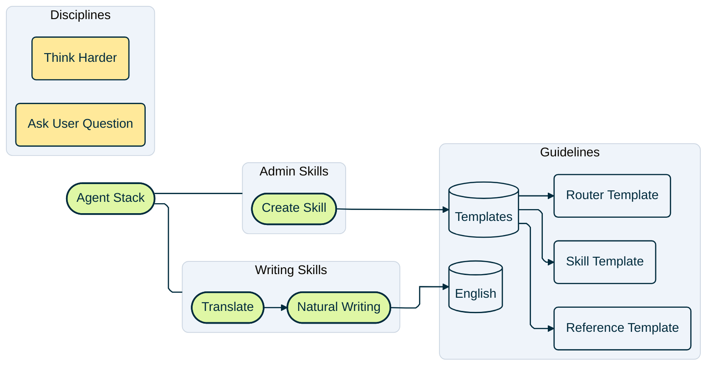
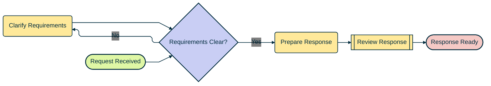

# Mermaid Diagrams – Best Practices

Create diagrams whose shapes explain each resource's role, whose groups explain its place, and whose connections are easy to trace. Use this standard for new diagrams and revisions. Follow explicit user requirements when they change the appearance, grouping, or scope.

## Purpose and diagram selection

Establish what the diagram explains before choosing its notation. A resource map shows available capabilities, reference material, and their relationships. A process flow shows actions, decisions, and outcomes over time. Both can use Mermaid flowchart syntax, but their nodes and connections have different jobs.

Use the native diagram family when the subject requires it: a sequence diagram for messages over time, a state diagram for transitions, an entity relationship diagram for data cardinality, or a timeline for dated events. Reuse the typography and transparent canvas where supported. Preserve that family's notation and supported configuration rather than imposing flowchart shapes or the ELK layout on it.

For a resource map, inventory the actual resources and read their relevant instructions before drawing dependencies. Empty or planned folders can appear as resources when requested; their presence does not establish an implemented capability or a dependency.

## Configuration

Use the following frontmatter as the default for resource maps and process flows. Put it at the start of the diagram, inside the Mermaid fence when embedding a diagram in Markdown. Keep all configuration in this one block; merge existing settings into it rather than adding a separate `init` directive.

```yaml
---
config:
  look: classic
  theme: base
  themeCSS: ".edgeLabel .labelBkg { background-color: transparent; }"
  layout: elk
  elk:
    considerModelOrder: NONE
    forceNodeModelOrder: false
    mergeEdges: false
    nodePlacementStrategy: NETWORK_SIMPLEX
  flowchart:
    curve: linear
  themeVariables:
    fontFamily: "Fira Code, monospace"
    background: "transparent"
    clusterBkg: "#EFF4FA"
    clusterBorder: "#CBD5E1"
    edgeLabelBackground: "transparent"
    primaryTextColor: "#002B3D"
    lineColor: "#002B3D"
---
```

This configuration travels with the diagram. The viewer must support frontmatter and provide the ELK layout engine; metadata cannot install either a renderer or a font. Use Fira Code when available and the monospace fallback otherwise. The label style keeps HTML branch-label backdrops transparent in viewers that add a backing span. Preserve canvas transparency in the viewer and exported file.

The layout settings permit node reordering, keep separate edges traceable, and provide a starting placement strategy. They do not guarantee short routes, source order, or identical results across viewers. Validate the actual rendering before changing those defaults. If a viewer cannot honor them, identify the limitation and verify any compatible alternative rather than silently claiming the same appearance.

## Shapes and colors

Assign each node a role before selecting its shape and style. Consider what a person or agent can enter, perform, invoke, consult, or complete. The same resource can have a different role in a resource map and in a detailed workflow.

| Meaning | Shape and Mermaid syntax | Fill | Text and outline |
| --- | --- | --- | --- |
| Stack or skill entry point | Stadium: `entry(["Translate"])` | Green `#DFF7A5` | Navy `#002B3D` |
| Discipline or ordinary work step | Rounded rectangle: `task("Think Harder")` | Yellow `#FFE99A` | Navy `#002B3D` |
| Explicit predefined subprocess | Double-sided rectangle: `review[["Review Response"]]` | Yellow `#FFE99A` | Navy `#002B3D` |
| Guidelines or stored knowledge | Cylinder: `knowledge[("English")]` | Gray `#EFF4FA` | Navy `#002B3D` |
| Individual reference or template | Rounded rectangle: `reference("Skill Template")` | Gray `#EFF4FA` | Navy `#002B3D` |
| Actual branching decision | Diamond: `check{"Requirements Clear?"}` | Lavender `#C9CEF4` | Navy `#002B3D` |
| Completion or stop | Stadium: `finish(["Response Ready"])` | Coral `#F5C9C5` | Navy `#002B3D` |
| Category or section | Named subgraph with 8px rounded corners | Gray `#EFF4FA` | Navy text `#002B3D`; muted gray border `#CBD5E1` |
| Connection | Plain line or arrow, according to its meaning | No fill | Navy `#002B3D` |
| Canvas and edge-label backdrop | Transparent | No colored backdrop | — |

A skill selected to begin work is an entry point. A discipline such as Think Harder or Ask User Question describes work and uses a yellow rounded rectangle. Reserve the double-sided rectangle for a separately defined subprocess explicitly invoked within the depicted workflow. Round ordinary rectangles and section corners while retaining the silhouettes of specialized symbols.

A cylinder can represent a consulted collection of reference knowledge without asserting a particular database technology. For a single-file collection, the cylinder is sufficient. For a collection containing multiple files, add a child node for each file. Keep an empty collection as a cylinder without inventing contents.

Preserve these meanings throughout the diagram. Use lavender only for a real decision and coral only for completion or stopping. A category name alone does not justify a new color. Shapes, labels, and relationships must convey meaning even without color.

## Grouping and relationships

In a skill-stack resource map, assign each skill to one meaningful domain section, such as Business Skills, Marketing Skills, Design Skills, or Engineering Skills. Use subgraphs as the category containers, with no extra category cells inside them. Connect the stack directly to those sections. Keep disciplines in their own section and put all guideline collections and their expanded files inside one flat Guidelines section.

Preserve the user's grouping and level of detail. Do not introduce nested sections, split Guidelines into separate sections, or move resources into new categories merely to improve routing. Resolve layout problems within the agreed structure, and explain a remaining limitation when the renderer cannot satisfy it.

Use `---` for organization or membership connections and `-->` for a directed dependency, invocation, or process transition. In resource maps, dependency arrows must be supported by explicit source references or verified handoffs. Represent a reference through an intermediary as a chain: Translate points to Natural Writing, and Natural Writing points to its language guidelines. Topical similarity does not establish a direct dependency.

Keep resource-map connections unlabeled by default. Add a label only when it supplies necessary meaning or the user requests it. In process flows, label decision branches with their outcomes, such as Yes and No. Use `-.->` for an optional or exceptional relationship only when a visible label or legend defines that meaning. Preserve requests for resources to remain unconnected.

## Layout and labels

Use `flowchart LR` by default. Let real dependencies determine the flow columns, with related peers arranged vertically within a column. Use another direction when it makes the subject easier to follow. Avoid imposing conflicting directions on subgraphs; some renderers ignore a local direction when nodes connect outside their container.

Place connected resources close together. Prefer short, traceable routes with few bends, crossings, and overlaps. Judge these qualities together: zero crossings do not justify long loops, backtracking, or lines passing through unrelated nodes. Keep separate routes distinguishable at branches. Declaration order is a secondary preference when it does not worsen the connections.

When routing is poor, compare supported placement strategies, spacing, and renderer behavior while preserving the nodes, relationships, and agreed groups. Inspect both the overall layout and the longest individual connections. Compare route lengths and bends in the same renderer, and reject unnecessary U-shaped detours. Do not claim a mathematically shortest layout from a visual check.

Do not add invisible chains merely to sort peers. Such links add rank constraints and can turn parallel resources into successive flow columns. Do not reverse a real dependency or add an unsupported relationship to obtain a preferred placement.

Give each node a stable identifier, using lowercase words and underscores, and a separate quoted label. Use readable resource names such as Market Research, Audit UX, and TypeScript. Omit directory slashes, slug hyphens, file extensions, and prefixes such as Document. Preserve punctuation that belongs to an actual name. Use concise action labels for work steps and clear questions for decisions. Avoid reserved identifiers such as `end`.

## Shared styles and syntax

Define each shared style once with `classDef`, then assign it to all matching nodes with a comma-separated `class` statement. Keep definitions and assignments together after the connections. Knowledge stores and their document nodes can share one reference class because their shapes already distinguish them. Define only the classes the diagram uses.

Use one section class, `classDef section rx:8px,ry:8px`, and assign it to the subgraph identifiers together. Reserve individual `style` statements for exceptions. Confirm that the viewer applies classes to subgraphs as well as ordinary nodes.

Terminate statements with newlines and omit optional semicolons. In particular, do not place a semicolon immediately after a hex color in a style statement: Mermaid 10.9.5 can interpret a value such as `#002B3D;` as an entity and reject it. Use core shape syntax such as `(["Entry"])`, `("Task")`, `[["Subprocess"]]`, `[("Knowledge")]`, and `{"Decision?"}` unless the target renderer's support for another shape has been verified.

## Complete examples

Each example includes its own configuration and styles so it can be copied and rendered independently.

### Resource map

The map separates entry points, disciplines, knowledge stores, and files. English represents a single-file collection; Templates expands to show multiple files. Category connections are plain lines, dependencies are arrows, and the disciplines remain unconnected.



### Process flow

This flow uses a decision and a real clarification loop. Review Response is a predefined subprocess; Response Ready is the completion point. The same palette retains its meanings across both examples.



## Validation and delivery

Validate the complete saved diagrams, including their frontmatter and styles. When editing this guide, extract every fenced Mermaid example and check each independently.

1. **Check meaning.** Compare the nodes, relationships, and groups with the sources and requested scope. Confirm that direct references are real, single-file collections are collapsed, and requested grouping is preserved.
2. **Check syntax and configuration.** Parse every complete diagram. Confirm that all examples use the canonical configuration and that colors match their roles. A successful parse can still ignore unsupported renderer settings.
3. **Render in the target viewer.** Use its Mermaid version and an available ELK engine. For this guide, the reference rendering environment is Mermaid **11.17.2** with **@mermaid-js/layout-elk 0.2.0**. Mermaid **10.9.5** can provide an additional legacy syntax check; it does not establish support for the current ELK configuration or appearance.
4. **Inspect the result.** At a readable scale, check text, shapes, node fills, rounded section borders, canvas transparency, and traceable connections. Inspect route length, unnecessary bends, direction reversals, crossings, and overlaps together. Check that no labels or nodes are clipped and that the renderer has not introduced misleading order.
5. **Recheck after repairs.** Parse and render the saved revision after any changes. Keep temporary dependencies and previews outside the repository unless the user requests them. Report the versions and checks that actually ran, and state any remaining limitation without claiming unverified appearance or optimal routing.
